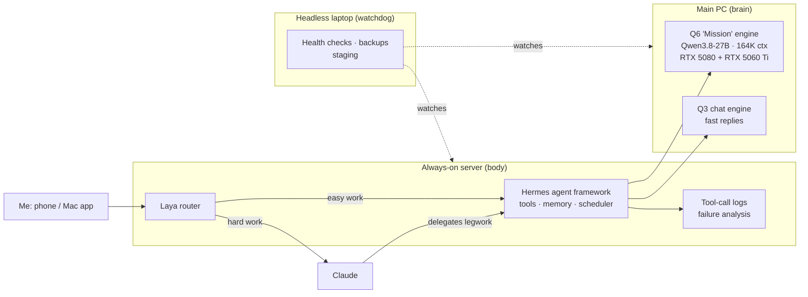

# Kairos: a local AI agent system, and what it taught me

**Lavian Schwartz** · Co-founder, Interstitium Games · October 2026 to present
*Numbers are as of November 3, 2026.*

Kairos is a self-hosted AI agent system that runs on four of my own machines. It does multi-step work for me (research, file work, scheduled jobs, coding helpers), so I can save my Claude usage for the work that needs it. I started it to learn how these systems actually behave, not just how they're described. It turned into a small research program: every change gets measured, most ideas fail, and the failures have taught me the most.

This page covers what I built, what I measured, and what I got wrong.

---

## How this was built

I set the goals and made the calls on what to try, ship, or drop. **Claude (Anthropic) was my engineering partner throughout.** It wrote most of the code and worked through much of the analysis with me. Kairos is a private, non-commercial assistant. It is not sold or offered to anyone else.

---

## Architecture

- **Model:** Qwen3.8-27B (a reasoning-tuned community variant), dense, quantized by me to UD-Q6_K with a q8_0 KV cache. It's split across an RTX 5080 and an RTX 5060 Ti 16GB with a 164K-token context. A faster Q3 build serves chat when no long task is running.
- **Runtime:** llama.cpp with speculative decoding through the model's built-in multi-token-prediction (MTP) draft head.
- **Agent layer:** the Hermes agent framework on an always-on server, with a watchdog laptop for health checks and backups.
- **Hard stops:** autonomous runs physically cannot spend money, send messages as me, delete outside their workspace, or touch secrets. These are **enforced in code, not in the prompt**, and they ping me when triggered.

---

## 1. Where tool calls go wrong

Kairos makes a lot of tool calls, and a failed call wastes time even when it recovers. So I log every one and sort the failures.

| | |
|---|---|
| Tool calls logged | **20,510** |
| Failed | 384 (**1.9%**), 350 recovered on the next turn |
| Categorized failures by type | judgment **158** · format **129** · infrastructure **47** |

**Finding:** most format failures came from the agent harness, not the model. llama.cpp can constrain tool calls with a grammar (the tool name must exist, required arguments must be present, typed arguments are checked), and the leaner runner I'm moving to already uses it. **Judgment** errors (calling the wrong tool, or not knowing when to stop) are the real open problem. A grammar can't fix them.

---

## 2. Retraining the speculative-decoding draft head

A better draft head means faster generation at *identical* output quality, because the main model verifies every drafted token. I ported the model's MTP head (one transformer block, about 0.4B parameters) to PyTorch. Before training anything, I checked that the port reproduced the stock head's measured agreement. Then I trained it on the model's own hidden states with a KL loss against the model's top-32 next-token distribution, and set the bar as **acceptance rate measured in the real engine**, not an offline metric.

| | Offline top-1 | Engine acceptance (Q6) | Engine acceptance (Q3) |
|---|---|---|---|
| Stock head | 0.759 | 0.690 | 0.695 |
| My head v1 | **0.780** | 0.692 | 0.672 |

It beat the stock head offline but not in the engine, so **it didn't ship.** The likely cause is that the engine drafts two tokens and runs the head on its *own* first guess, while I only trained the first step. I also trained on Q6 hidden states for a head that serves the Q3 model. Version 2 trains the chained step against the matching model.

A smaller win from the same work: switching from greedy drafting to **probabilistic drafting** (rejection sampling, which keeps the exact output distribution) raised acceptance from 0.52 to 0.68.

---

## 3. Laya: a learned router

Every message I send gets routed, either to Kairos or to a Claude model at a chosen thinking level. **Laya** is a small model that learns those routing decisions from a log of every pick and what I did next: I accepted it, switched up, switched down, or later said the answer was weak. It weights **under-routing** (too weak a model) more heavily than over-routing, because a wrong cheap answer costs more than an expensive right one. It runs in **shadow mode**, scored against real decisions, and only gets switched on once it beats the baseline.

---

## 4. Measured inference tuning

Nothing ships on vibes. A few results:

- Batch size `-b 1024`: **+17–19%** prompt-processing speed (shipped)
- Presence penalty 0.0 for long agent tasks: about **30% less wall time** (shipped)
- Tensor-split changes and `-ub 512`: no gain (rejected)

---

## What I'd tell myself a month ago

- **Infrastructure fails more than the model does.** Most slowdowns and many tool-call failures came from the plumbing, not the LLM.
- **Long autonomous runs are hard.** Even with hard stops, a plan, and a final audit, almost none of my multi-hour runs finished without me stepping in. Reliable agent behavior is an open problem for a reason.
- **Offline metrics can lie.** My draft head looked better on paper and wasn't better where it counted. Gate on the real system.
- **Negative results are results.** My biggest experiment didn't ship, and it told me exactly what to change.

## What's next

Version 2 of the draft head (training the chained step), a full move to the grammar-constrained runner, switching Laya on once it beats the baseline, and moving the whole stack to headless Linux.
